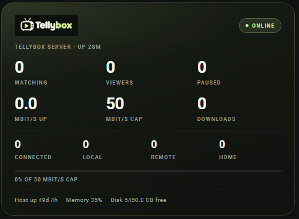

# Tellybox for Home Assistant

A small, read-only Home Assistant custom integration for Tellybox. It polls one versioned statistics endpoint every 30 seconds and exposes aggregate stream, download, upload and server health values.

The repository also includes a native sections dashboard with a dark/lime Tellybox theme, a native compact card and an optional custom button-card panel. The full dashboard and compact card use only built-in Lovelace cards: no custom cards, card-mod or frontend dependencies. The optional button-card panel needs the `button-card` frontend card, installed separately through HACS.

This is a custom repository. It is not an official Home Assistant integration and it is not in the default HACS catalogue. Add the repository URL manually as described below.

The Tellybox server and the HomeLab installation guide live in the separate public [Tellybox HomeLab repository](https://github.com/jharrisuk/tellybox-homelab). That repository links back to this Home Assistant integration repository. Use it for server installation, the token screen and the full HomeLab walkthrough.

## Requirements

- Home Assistant 2026.10.0 or newer. The configuration flow uses `probatio`, the schema library used by Home Assistant config flows from 2026.10. Home Assistant 2026.9 and earlier used `voluptuous` and cannot load this flow.
- HACS, or the Marketplace built into Home Assistant 2026.11 and newer.
- A Tellybox server that provides `GET /api/integrations/home-assistant/stats` with schema version 1.
- A dedicated read-only Home Assistant token created in the existing Tellybox installation settings.
- Network access from Home Assistant to the Tellybox viewing address: the local reverse proxy at `http://tellybox.local` (port 80), or the direct address `http://SERVER_IP:8082`.

## Create the Tellybox token

1. Open your existing Tellybox installation settings at `http://SERVER_IP:8990` and sign in as the installation administrator. Local viewing through the reverse proxy or on port 8082 does not grant administrator access.
2. Find the **Home Assistant** section and choose **Create token**.
3. Copy the token immediately. It is shown only once. If you lose it, rotate the token in Tellybox and update the integration.

The token is read-only, revocable and separate from viewer cookies, app access tokens and the installation administrator password. There is no local-network bypass: a request without the bearer token receives `401`, even from the server itself.

## Install from this custom repository

The repository URL is:

```text
https://github.com/jharrisuk/tellybox-home-assistant
```

### Install through HACS

1. In Home Assistant, open **HACS > Integrations**.
2. Open the three-dot menu and choose **Custom repositories**.
3. Add the repository URL above with category **Integration**.
4. Search for **Tellybox** in HACS and choose **Download**.
5. Restart Home Assistant. A newly downloaded or updated custom integration is not loaded until Home Assistant restarts.
6. Open **Settings > Devices and services > Add integration**, search for **Tellybox**, then enter the details below.

### Install through the Marketplace (Home Assistant 2026.11 or newer)

1. Open **Settings > Marketplace**.
2. Select **Add from link** in the upper-right corner.
3. Enter the repository URL above and select **Add**. The Marketplace asks you to connect GitHub if needed.
4. Open the **Tellybox** repository and select **Install**.
5. Restart Home Assistant if the Marketplace asks for a restart.
6. Open **Settings > Devices and services > Add integration**, search for **Tellybox**, then enter the details below.

### Add the integration entry

Enter:

- **Server address:** `http://tellybox.local` if the existing local reverse proxy resolves from Home Assistant. That proxy serves Tellybox on port 80, so do not add `:8082` to the hostname. If the proxy or hostname is not available, use `http://SERVER_IP:8082` instead. Use `https://` if the address crosses an untrusted network.
- **Home Assistant token:** the token from the step above.

The integration validates the address and token before creating the config entry. It uses the server's stable installation ID as the Home Assistant unique ID, so the same server is not added twice.

If the token is rotated or revoked, Home Assistant shows a reauthentication prompt. Enter the current token there. To change the server address or token later, use **Reconfigure** on the integration entry. Both flows keep the same installation identity and abort if the token belongs to a different Tellybox installation.

## Add the dashboard

The full dashboard and the compact alternative are native Lovelace YAML. They use sections, heading, picture, tile and gauge cards, a history graph and Markdown cards. The optional custom button-card panel in step 5 needs one HACS frontend dependency, `button-card`; the other dashboard files need nothing from HACS frontend repositories.

### 1. Optional dark/lime theme

The supplied theme is a normal Home Assistant theme, not a custom card or frontend dependency.

1. Copy `themes/tellybox.yaml` from this repository into a `themes` folder in your Home Assistant configuration directory.
2. Add this to `configuration.yaml` if it is not already present:

   ```yaml
   frontend:
     themes: !include_dir_merge_named themes
   ```

3. Restart Home Assistant, or run the **Frontend: Reload themes** action.

If you skip this step, remove `theme: Tellybox` from the dashboard view so it uses your normal theme.

### 2. Create the dashboard

1. Open **Settings > Dashboards** and choose **Add dashboard > New dashboard from scratch**.
2. Open the new dashboard, select **Edit dashboard**, open the three-dot menu and choose **Raw configuration editor**.
3. Replace the editor contents with the contents of `dashboard-example.yaml`.
4. Save the dashboard.

### 3. Replace the entity IDs

Entity IDs depend on the config entry title, so the IDs below are placeholders. Open **Settings > Devices & services > Tellybox > Entities**, copy the real entity IDs, and replace every placeholder in the dashboard.

| Placeholder | What it shows |
| --- | --- |
| `binary_sensor.tellybox_online` | Whether the last statistics poll succeeded. |
| `sensor.tellybox_active_streams` | Streams currently playing. |
| `sensor.tellybox_connected_streams` | Sessions inside the server's recent window. |
| `sensor.tellybox_local_streams` | Connected sessions using the direct local route. |
| `sensor.tellybox_remote_streams` | Connected sessions using the remote relay route. |
| `sensor.tellybox_active_downloads` | Current downloads. |
| `sensor.tellybox_measured_remote_upload` | Measured remote upload in Mbit/s. |
| `sensor.tellybox_configured_upload_limit` | Configured upload cap in Mbit/s. `0` means unlimited. |
| `sensor.tellybox_service_uptime` | Tellybox service uptime. |
| `sensor.tellybox_cpu_usage` | Host CPU percentage. |
| `sensor.tellybox_memory_usage` | Host memory percentage. |
| `sensor.tellybox_viewers` | Distinct people watching now. |
| `sensor.tellybox_paused_streams` | Sessions paused inside the server's recent window. |
| `sensor.tellybox_play_requests_24_hours` | Play requests recorded by the server in the last 24 hours. |
| `sensor.tellybox_failed_or_limited_sign_ins_24_hours` | Failed or limited sign-in attempts in the last 24 hours. |
| `sensor.tellybox_host_uptime` | Host uptime, separate from the service uptime. |
| `sensor.tellybox_memory_total` | Host memory total. |
| `sensor.tellybox_memory_available` | Host memory available. |
| `binary_sensor.tellybox_maintenance_mode` | On while maintenance mode is active. |

The **Overview** and **Storage** cards are scoped to one entry. They use `device_id('binary_sensor.tellybox_online')` to find the device and `device_entities()` to list only that device's entities, then match the explicit placeholder IDs above. They do not match English entity names. Replace every placeholder consistently with the entity IDs from the same Tellybox entry, including the online ID used by both cards. Entities from another Tellybox installation are ignored, so a multi-installation system does not blend values. Storage lists only `data_size` sensors on that device.

Storage is shown in GB or TB. The disk sensors keep their native bytes value and stable unique ID, but Home Assistant displays GB by default for new entities. If an existing disk entity still shows bytes, change its unit to GB in the entity settings; the dashboard storage table handles either unit.

Unknown or unavailable readings render as an em dash (`—`) in the Markdown cards, and as unavailable in the native cards. They are never turned into `0`. A real zero reported by Tellybox, such as no active streams, still shows `0`.

### 4. Optional compact panel

`dashboard-compact-card.yaml` is one compact native Lovelace vertical-stack card. It uses a native picture card for the logo and a native **Details** button. It shows status, active streams and downloads, local and remote sessions, upload rate and cap, and compact GB/TB storage. It does not use custom cards.

1. In any dashboard, choose **Edit dashboard > Add card > Manual**, or open the raw configuration editor and paste the card under `cards:`.
2. Copy the whole contents of `dashboard-compact-card.yaml`.
3. Replace every `sensor.tellybox_*` and `binary_sensor.tellybox_online` placeholder with entity IDs from the same Tellybox entry. Use `http://tellybox.local` as the default integration address when the local reverse proxy resolves; use `http://SERVER_IP:8082` only as the direct fallback.
4. The **Details** button navigates to `/dashboard-tellybox/tellybox`. If you install the card on that view itself, change `navigation_path` to a separate details subview, such as `/dashboard-tellybox/details`, and set `subview: true` on that view so it does not appear as a second normal tab.
5. The shared card uses Home Assistant's local brand route for the wordmark in a native picture card, which signs the request. For a personal preview only, you may replace it with `/local/dark_logo.png` after copying the supplied logo there.

The compact card keeps unknown values as `—`; it never turns a missing reading into `0`. Extra metrics such as connected sessions, uptime, CPU, memory and the full disk table remain in the full dashboard or a details subview.

### 5. Custom button-card panel (optional)

`dashboard-button-card.yaml` is one `custom:button-card` panel in the supplied dark/lime Tellybox style. It shows the wordmark, server status, uptime, active streams, upload rate and cap, connected/local/remote sessions, downloads and an upload meter. The native compact card in step 4 remains the no-dependency alternative.

#### Install the button-card frontend dependency

1. In Home Assistant, open **HACS > Frontend**.
2. Search for **button-card**, open it and choose **Download**.
3. Reload the browser when HACS asks. If the card is still reported as missing, restart Home Assistant and hard-refresh the browser.
4. This is the Lovelace `button-card` frontend card, not a Tellybox integration and not a custom repository. Do not add it as an integration.

`dashboard-button-card.yaml` uses only `custom:button-card`. It does not need card-mod or any other frontend dependency.

#### Put the existing Tellybox wordmark in a portable location

The integration already ships the wordmark at `custom_components/tellybox/brand/dark_logo.png`. No new brand asset is added for this card.

1. In your Home Assistant configuration directory, create `www/tellybox/` if it does not exist.
2. Copy `custom_components/tellybox/brand/dark_logo.png` to `www/tellybox/dark_logo.png`.
3. The card then uses `/local/tellybox/dark_logo.png`, which Home Assistant serves from `www/tellybox/dark_logo.png`.
4. If you keep the image elsewhere, change the `logo` variable once. Set `logo: ''` to show a plain text wordmark instead.

Only copy the wordmark that is already bundled with this integration. Do not add a separate logo file or a new brand variant.

#### Add the card and set the prefix once

1. Open any dashboard, choose **Edit dashboard > Add card > Manual**, or open the raw configuration editor and add the card under `cards:`.
2. Copy the whole contents of `dashboard-button-card.yaml`.
3. Set `entity_prefix` once in the card's `variables` block. The default `tellybox_tellybox_local` matches the default integration entry title **Tellybox (tellybox.local)**, which creates IDs such as `sensor.tellybox_tellybox_local_active_streams` and `binary_sensor.tellybox_tellybox_local_online`.
4. If your entity IDs differ, open **Settings > Devices & services > Tellybox > Entities**, copy the shared prefix from one sensor, and replace `tellybox_tellybox_local` once. Use only the shared prefix. A leading `sensor.` or `binary_sensor.` is ignored, but do not paste the final entity name as well.
5. Leave `logo: /local/tellybox/dark_logo.png` unless you placed the wordmark somewhere else.
6. Save the dashboard.

The card assumes the default Tellybox integration address `http://tellybox.local`. That address is configured on the integration entry, not in the card. If the local reverse proxy does not resolve, use `http://SERVER_IP:8082` on the integration entry as described above.

#### What the card does with awkward values

- **Unknown or unavailable:** the status pill says **UNKNOWN**, and affected readings show `—`. Missing values are never converted to `0`; a real zero from Tellybox still shows `0`.
- **Unlimited upload cap:** a configured cap of `0` shows `∞`, the small label says **Unlimited cap**, and the meter reads **Unlimited upload cap**. No division is attempted.
- **Invalid numbers:** malformed, negative or non-numeric readings stay `—`. The card does not print `NaN` or `Infinity`.
- **Uptime units:** seconds, milliseconds, microseconds, minutes, hours, days and weeks are converted to a compact `1d 2h`, `2h 15m` or `45m` form. An unrecognised unit shows `—` rather than the raw state.
- **HTML safety:** entity units, uptime text and the logo path are HTML-escaped before they enter the panel markup, so a malformed attribute cannot inject HTML.
- **Multiple installations:** the prefix selects one Tellybox installation. Use a separate card with a different `entity_prefix` for a second installation.

For the full native dashboard, see step 2. For the native compact card with no frontend dependency, use `dashboard-compact-card.yaml` from step 4.

## Branding

The integration ships its own brand assets in `custom_components/tellybox/brand/`:

- `icon.png` (256 × 256) and `icon@2x.png` (512 × 512), derived from the Tellybox icon artwork.
- `dark_logo.png` (768 × 256) and `dark_logo@2x.png` (1536 × 512), derived from the Tellybox wordmark.

Home Assistant 2026.3 and newer serve brand images stored inside a custom integration, so the Home Assistant integration page can show the Tellybox icon without a pull request to the separate Home Assistant brands repository. Local images take precedence over any brands-repository images, and the HACS validator accepts the same local `brand` assets. The dashboard header uses the same local wordmark through Home Assistant's verified brand API route, `/api/brands/integration/tellybox/dark_logo.png`, in a native picture card; the frontend adds the short-lived brands token for that request.

HACS may still show a cached or remotely fetched catalogue thumbnail instead of the local asset. HACS has its own brand-image lookup and cache, and this repository cannot correct every HACS UI version. That is a HACS display issue, not a missing asset here. Current examples are HACS issues [#5402](https://github.com/hacs/integration/issues/5402) and [#5171](https://github.com/hacs/integration/issues/5171). The local branding works in Home Assistant even when a HACS catalogue thumbnail is stale.

The supplied wordmark is a dark-background asset. Only the dark logo is bundled; outside the Tellybox dashboard, light mode Home Assistant falls back to the square icon rather than inventing a light-background wordmark. The icon and logo are Tellybox brand assets. They are included so Home Assistant can identify this integration and are not a general-purpose artwork licence.

The HACS validation workflow checks the integration, brand assets and repository layout. Only the `license` check is skipped, because the PolyForm Noncommercial licence is not OSI-approved and this repository is not submitted to the default catalogue. Custom repository installation does not require that check.

## Updates and releases

- HACS or the Marketplace offers an update when a new GitHub release is published. The repository version is `0.2.1`.
- Choose **Update**, then restart Home Assistant. Replacing files alone does not reload the Python integration. The Marketplace shows a repair when a restart is needed.
- HACS and the Marketplace use published GitHub releases. A tag without a published release is not enough.
- This repository is not in the default catalogue. Every user must add the custom repository URL above. It is not discovered, installed or updated automatically outside HACS or the Marketplace.

## What it reads

The integration only calls `GET /api/integrations/home-assistant/stats`. It never reads the normal viewer API and exposes only these aggregate values:

- Active, connected, local, remote, paused and viewer stream counts.
- Active download count.
- 24-hour play and failed sign-in counts.
- Measured remote upload rate and the configured upload cap.
- Tellybox service uptime and host uptime.
- Host CPU and memory percentages from the existing host-health collector.
- Total and available host memory in bytes.
- Available bytes for each host disk, keyed by a stable sanitised disk ID.
- A connectivity binary sensor and a maintenance-mode binary sensor.

It does not expose viewing titles, history, account details, IP addresses, file paths, provider URLs or any write action.

## Entities

Entity IDs depend on the config entry title, which includes the server address. Use the entity IDs shown in Home Assistant.

| Translation key | Typical entity | Meaning |
| --- | --- | --- |
| `active_streams` | `sensor...active_streams` | Playback sessions currently playing. |
| `connected_streams` | `sensor...connected_streams` | Sessions inside the server's recent window, including paused sessions. |
| `local_streams` | `sensor...local_streams` | Connected sessions using the direct local media route. |
| `remote_streams` | `sensor...remote_streams` | Connected sessions using the remote relay route. |
| `paused_streams` | `sensor...paused_streams` | Paused playback sessions. |
| `viewers` | `sensor...viewers` | Current viewers across active sessions. |
| `active_downloads` | `sensor...active_downloads` | Current downloads. |
| `plays` | `sensor...play_requests_24_hours` | Play requests in the last 24 hours. Diagnostic. |
| `failed_plays` | `sensor...failed_or_limited_sign_ins_24_hours` | Failed or limited sign-in attempts in the last 24 hours. Diagnostic. |
| `measured_remote_upload` | `sensor...measured_remote_upload` | Measured remote upload in Mbit/s. |
| `configured_upload_limit` | `sensor...configured_upload_limit` | Configured upload cap in Mbit/s. `0` means unlimited. |
| `uptime` | `sensor...service_uptime` | Tellybox service uptime. |
| `host_uptime` | `sensor...host_uptime` | Host uptime. Diagnostic. |
| `cpu_usage` | `sensor...cpu_usage` | Host CPU percentage. |
| `memory_usage` | `sensor...memory_usage` | Host memory percentage. |
| `memory_total` | `sensor...memory_total` | Total host memory. Diagnostic. |
| `memory_available` | `sensor...memory_available` | Available host memory. Diagnostic. |
| Disk sensor | `sensor...available_space` | Free space for one disk. Native bytes, displayed in GB by default. |
| `online` | `binary_sensor...online` | Whether the last statistics poll succeeded. |
| `maintenance` | `binary_sensor...maintenance_mode` | Whether the server's maintenance mode is enabled. Diagnostic. |

A value is unavailable when the server reports it as missing or stale. The integration does not turn missing CPU, memory, uptime or disk readings into zero. A real zero, such as no active streams, remains `0`.

See `dashboard-example.yaml` for the native sections dashboard. Replace the placeholder entity IDs with the ones Home Assistant created.

## Troubleshooting

- **`invalid_auth`:** the token was revoked, rotated or copied incorrectly. Create or rotate a token in Tellybox installation settings.
- **`cannot_connect`:** check the local reverse proxy, the direct port 8082, Docker port publishing and Home Assistant network access. If `http://tellybox.local` does not resolve from Home Assistant, use `http://SERVER_IP:8082`.
- **`invalid_response`:** the server is older than the stats schema, or a proxy returned HTML. Check that the address points at Tellybox directly and that the endpoint path is correct.
- **CPU, memory or disk sensors unavailable:** the host-health collector has not written a fresh sample. Tellybox service uptime can remain available while host readings are missing.
- **Integration will not load:** confirm Home Assistant is 2026.10.0 or newer. Earlier releases do not provide the schema library used by this config flow.
- **Dashboard shows placeholder entities:** replace the `sensor.tellybox_*` and `binary_sensor.tellybox_online` placeholders with the entity IDs from one entry. Replace the online ID in both the header badge and the two Markdown cards so their device-scoped lookups use the same installation.
- **Update downloaded but nothing changed:** restart Home Assistant after the HACS update.

## Remove

1. Remove the Tellybox integration entry in **Settings > Devices and services**.
2. Remove the repository in HACS.
3. Restart Home Assistant.

## Development checks

From the repository root:

```text
python -m pytest
```

The test suite covers URL and token validation, the statistics allowlist, failure mapping, config and reconfiguration flows, entity translation keys, disk unit conversion through Home Assistant, dashboard YAML and template syntax, the compact card, the button-card and panel-card YAML and JavaScript behaviour, and packaging requirements. CI also runs the button-card and panel-card logic tests, the HACS validation action and hassfest.

## Licence

The integration, tests, documentation, dashboard example and theme in this repository are source-available under the PolyForm Noncommercial License 1.0.0. See `LICENSE`, `NOTICE` and `LICENSE-SCOPE.md`. This is not an OSI-approved open-source licence. Commercial use requires separate permission from the rightsholders. Third-party components, including Home Assistant and HACS, remain under their own licences. Tellybox brand assets are included for integration identification and are not licensed as general-purpose artwork.

### 6. Full panel card (optional)


`dashboard-panel-card.yaml` is a wider `custom:button-card` panel for the new
statistics. It shows status and maintenance, who is watching, paused sessions,
upload against the cap, downloads, connected/local/remote sessions, host and
service uptime, memory use and free disk space, plus a play count when the
server reports one.

It uses the same `entity_prefix` and `logo` variables as
`dashboard-button-card.yaml`, so set the prefix once in the same way.

- **Maintenance:** the status pill reads **MAINTENANCE** in amber only while the
  online sensor confirms the poll is succeeding. If the poll fails, **OFFLINE**
  wins over a last-seen maintenance flag, because an unreachable server cannot
  confirm that maintenance mode is still active.
- **Missing values:** every reading falls back to an em dash. The play count
  reads `sensor.<prefix>_play_requests_24_hours` and falls back to the older
  `sensor.<prefix>_plays` suffix; the footer labels it **plays · 24h**. The disk
  line scans the states for the first sensor ending
  `_available_space` (for example `_media_disk_available_space` or
  `_media_available_space`), preferring one whose ID contains `media`, and
  uses that sensor's own unit. Memory prefers `sensor.<prefix>_memory_usage` and
  falls back to the total/available byte calculation only when it is absent.
- **Compatibility:** a server that does not send the newer fields leaves those
  entities unavailable, and the card shows dashes rather than zeros.

Install the button-card frontend dependency and copy the wordmark exactly as
described above. This card does not need card-mod.